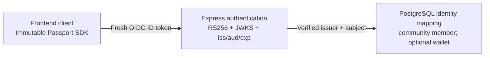

# Immutable Passport integration

## Implemented trust flow

In Passport mode, the frontend sends a fresh ID token in the
`Authorization: Bearer <ID token>` header. The API accepts only RS256 and
verifies the signature through the configured HTTPS JWKS endpoint, exact
issuer, Passport client ID as audience, and token time claims. It requires
`sub`. The optional `sid` claim is retained when the issuer provides it; issuer
and subject identify the mapped account.

The wallet is not read from a request body, query, path, or undocumented token
claim. A verified `(iss, sub)` resolves either through
`passport_community_member_bindings` to a community profile, or through
`passport_wallet_bindings` to a profile and server-owned wallet. Only the
second binding grants property access through `wallet_property_access`;
`GET /api/community/me/properties` rejects identities without that wallet
binding. A valid but unmapped identity is forbidden (403); a missing or
invalid token is unauthorized (401).

## Required external configuration

- Create/configure the Passport application in Immutable Hub and obtain its
  public client ID.
- Record the exact issuer emitted for that application/environment; do not
  guess it.
- Register the frontend callback, logout, and allowed origins in the provider.
- Set `VITE_COMMUNITY_DEMO_MODE=false` and provide the public
  `VITE_IMMUTABLE_PASSPORT_CLIENT_ID`, `VITE_IMMUTABLE_REDIRECT_URI`, and
  `VITE_IMMUTABLE_LOGOUT_URI` frontend settings.
- Configure `COMMUNITY_AUTH_MODE=immutable-passport`,
  `IMMUTABLE_PASSPORT_CLIENT_ID`, and `IMMUTABLE_PASSPORT_ISSUER`.
- The default JWKS is `https://auth.immutable.com/.well-known/jwks.json`;
  override `IMMUTABLE_PASSPORT_JWKS_URI` only with the provider-documented
  HTTPS endpoint.
- Populate subject/member bindings only from server-verified issuer and subject
  claims. Migration 009 provides this wallet-independent community mapping;
  it does not grant wallet or property access. Wallet/property bindings remain
  a separate reviewed administrative operation and must never use a
  client-submitted or inferred wallet.

No Passport credentials or bearer tokens belong in source control or logs.
The frontend uses the Passport SDK when demo mode is disabled and obtains the
current ID token for each authenticated API call rather than persisting it in
local storage. Its default local demo mode does not load Passport.

If a future linking workflow queries Passport linked addresses, use the
appropriate Passport access token server-side and verify the provider
response. Do not let a caller choose the wallet/property association.

## Isolated local Passport development

`apps/api/scripts/provisionGameplayDev.ps1` creates a new
`orden_margen_gameplay_dev` database owned by `odm_accounts_test`, a dedicated
limited API role, and an ignored `apps/api/.env.gameplay-dev` profile. It
refuses to overwrite the profile or create the database/role if either already
exists. Run it from PowerShell at the repository root; it prompts for the
local PostgreSQL administrator password using hidden input. Review all
migrations before running them: the legacy `001_initialize_equipment_tiers`
migration drops two named equipment tables, so run the full migration set
only against a verified empty database.

`apps/api/scripts/linkPassportDevelopmentIdentity.js` is a one-time local
linker. It only runs against that development database with gameplay disabled,
listens on loopback, accepts requests only from `http://localhost:8000`, and
verifies the submitted ID token's RS256 signature, issuer, audience, and
expiry against the configured JWKS before storing its issuer/subject mapping
to the dedicated `Passport Developer` community member. The token is sent
directly from the SDK session to the loopback listener and is not logged or
persisted. This development mapping has no wallet binding and grants no
property access. Do not use this helper for production or shared databases.

## Development bridge

`COMMUNITY_AUTH_MODE=configured` accepts either an explicit server-owned token
map or the fixed public sample tokens enabled by `COMMUNITY_DEMO_AUTH=true`.
Both are development-only and are refused in production. Memory storage and
demo authentication are also refused in production.
